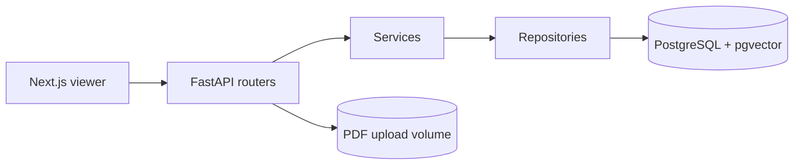

# Prism

Automated document proofing: upload a PDF and get clickable, evidence-backed issues pinned to its pages.

## Run with Docker

Copy `.env.example` to `.env`, then run `make up` and `make migrate`. The API is at http://localhost:8000, health at `/health`, database health at `/health/db`, and the web scaffold at http://localhost:3000.

## Run without Docker (macOS)

Install PostgreSQL 17 with pgvector. Set its port to `5433` before starting it so it can run alongside another local PostgreSQL instance. Homebrew's data directory is usually `/opt/homebrew/var/postgresql@17` on Apple Silicon and `/usr/local/var/postgresql@17` on Intel; edit `postgresql.conf` in that directory and set `port = 5433`. Then create the local database and enable the extension:

```bash
brew install postgresql@17 pgvector
brew services start postgresql@17
export PATH="$(brew --prefix postgresql@17)/bin:$PATH"
createdb -p 5433 auditor
psql -p 5433 auditor -c "CREATE EXTENSION IF NOT EXISTS vector;"
```

Copy `.env.example` to `.env`. Its local `DATABASE_URL` uses the current macOS username over the local PostgreSQL socket on port 5433. `make db-local` starts PostgreSQL 17 and creates/enables the database extension; use it only when you intend to start that service. In one terminal, install and run the API:

```bash
cd api
python3.12 -m venv .venv
source .venv/bin/activate
pip install -e '.[dev]'
cd ..
make migrate-local
make dev-api
```

In another terminal, run the web app:

```bash
cd web
npm install
npm run dev
```

The API is at http://localhost:8000 and the web app at http://localhost:3000. `make migrate-local`, `make dev-api`, `make dev-web`, and `make test` cover the remaining local workflows. Run `make test` after applying migrations and starting PostgreSQL because `/health/db` checks the live database.

## Phase 1: upload and sentence viewer

Install the API dependencies from `api/` and the web dependencies from `web/` using the commands above. Apply the new sentence-segment migration before launching the API:

```bash
cp .env.example .env
make migrate-local
```

Start `make dev-api` and `make dev-web` in separate terminals, then open http://localhost:3000. Upload a text-based PDF. The upload response creates a document and audit run; the API parses and embeds it in a synchronous FastAPI background task. The page shows ingestion progress, then a PDF viewer and a sentence chunk panel. Clicking a chunk highlights the corresponding word rectangles. The percentage-based overlay follows the rendered page at each zoom level.

The first audit downloads the FastEmbed model `BAAI/bge-small-en-v1.5` if it is not cached. A PDF with no text layer fails with a message that OCR is not available. The included [sample report PDF](samples/sample_report.pdf) has abbreviation/number examples, a sentence continuing across a page break, and an empty page. Regenerate it after installing API dependencies with `api/.venv/bin/python samples/create_sample.py` from the repository root.

Parser test coverage includes normalized bounding boxes, pysbd sentence boundaries (`Fig. 3`, `Inc.`, `e.g.`, `12.5%`, `$1.5M`, and a sentence ending in a number), multi-line sentences, cross-page sentence segments, rotated pages, empty pages, and scanned-PDF detection. Run the tests with `make test`; I have not run them in this environment.

The upload endpoints are `POST /documents`, `GET /documents/{id}/status`, `GET /documents/{id}/file`, and `GET /documents/{id}/pages/{n}/annotations`. Duplicate content hashes reuse the latest run, including returning a prior failed run's status and error rather than silently reprocessing it. Upload size and page limits are controlled by `MAX_UPLOAD_BYTES` and `MAX_PDF_PAGES`.

## Phase 2: facts and deterministic issues

Apply the Phase 2 migration, configure any LLM provider in `.env` (or set environment variables), and start the API and web app:

```bash
make migrate-local
# Configure your preferred LLM provider in .env or via standard environment variables:
# OpenAI, Anthropic, Gemini, Groq, Ollama, vLLM, OpenRouter, DeepSeek, or Fake
make dev-api
```

In another terminal run `make dev-web`, then upload a text-based PDF at http://localhost:3000. The audit extracts table-aware numeric/date facts, runs deterministic checks, and shows findings in the right-hand Issues feed. Use an issue's evidence links to navigate across cited pages. The API includes `GET /documents/{id}/issues?type=&severity=&status=`, `GET /documents/{id}/health`, and `POST /issues/{id}/feedback` with `{"feedback":"confirm"}` or `{"feedback":"false_positive"}`. `audit_runs.tokens_used`, `estimated_cost`, and `stage_timings` record extraction usage and duration.

### Universal LLM Provider & Auto-Detection

The API includes a **universal LLM adapter** supporting any cloud, self-hosted, or local provider without extra SDK dependencies. If `LLM_PROVIDER` is left at default or unset, the system **auto-detects** your provider based on existing environment variables:

| Provider | Environment Variable(s) | Default Model | API Endpoint | Notes |
| :--- | :--- | :--- | :--- | :--- |
| **OpenAI** | `OPENAI_API_KEY` or `LLM_API_KEY` | `gpt-4o-mini` | `https://api.openai.com/v1` | Standard OpenAI API |
| **Anthropic (Claude)** | `ANTHROPIC_API_KEY` | `claude-3-5-haiku-20241022` | `https://api.anthropic.com/v1/messages` | Native Messages API with `x-api-key` |
| **Google Gemini** | `GEMINI_API_KEY` or `GOOGLE_API_KEY` | `gemini-1.5-flash` | `https://generativelanguage.googleapis.com/v1beta/openai` | Google's OpenAI-compatible endpoint |
| **Groq** | `GROQ_API_KEY` | `llama-3.3-70b-versatile` | `https://api.groq.com/openai/v1` | Ultra-fast Llama inference |
| **OpenRouter** | `OPENROUTER_API_KEY` | `openai/gpt-4o-mini` | `https://openrouter.ai/api/v1` | Aggregator for 100+ models |
| **Ollama (Local)** | `OLLAMA_HOST` or `LLM_PROVIDER=ollama` | `llama3.2` | `http://localhost:11434/v1` | **No API key required!** |
| **vLLM / Local / LMStudio** | `LLM_PROVIDER=local` | `local-model` | `http://localhost:8000/v1` | **No API key required!** |
| **DeepSeek** | `DEEPSEEK_API_KEY` | `deepseek-chat` | `https://api.deepseek.com/v1` | High-efficiency reasoning models |
| **Azure OpenAI** | `AZURE_OPENAI_API_KEY` + `LLM_API_BASE` | `gpt-4o-mini` | Custom Azure URL | Authenticates with `api-key` header |
| **Fake / Test Client** | `LLM_PROVIDER=fake` | `fake-model` | N/A | **Zero cost & zero credentials** for CI/tests |

#### Robust JSON Parsing & Compatibility
- **Markdown & Conversational Stripper (`extract_json_payload`)**: Extracts valid JSON whether output as pure JSON, fenced in ```` ```json ... ``` ````, or surrounded by conversational introductory/trailing text.
- **`response_format` 400 Fallback**: If a local engine (e.g. older Ollama or custom vLLM proxy) rejects `response_format: {"type": "json_object"}` with HTTP 400, the client automatically disables the flag and retries.

### Hardened Deterministic Verification Engine

The mathematical consistency checks have been hardened against complex document layouts:

1. **Decoupled Bounding Boxes & Token Cost Optimization**:
   - Table prompts strip raw `[x0, y0, x1, y1]` float coordinates from the LLM prompt payload, reducing token consumption per table by **~80%** and preventing out-of-budget aborts on 50-page reports.
   - Precise bounding boxes remain cached in `TextChunk.table_cells` in the database and are resolved in $O(1)$ post-hoc lookup via `(table_row, table_col)` during issue generation.
2. **Contiguous-Block Columnar Summation (`sum_mismatch.py`)**:
   - Evaluates tables column-by-column across vertically sorted rows, grouping only contiguous items preceding each subtotal or total row.
   - Intermediate subtotals (*Total Current Assets*, *Total Non-Current Assets*, *Total Assets*) verify against their own sections and reset the accumulator, eliminating false positives caused by subtotal double-counting.
   - Header years (e.g., `2024`) and non-numeric labels are automatically suppressed from component parts.
   - Incorporates relative tolerance (`max(0.01, total * 0.005)`) to handle standard accounting rounding in financial statements.
3. **Row-Aligned Percentage Mismatch Detection (`percent_mismatch.py`)**:
   - When facts originate from tables with row indices, base, current, and percentage claims are strictly scoped to the same table row, preventing cross-row metric collisions.
4. **Multi-Line Header & Borderless Detection (`pdf_parser.py`)**:
   - Inspects rows 0 and 1 for section/date labels to detect multi-line headers and sets `header_row = 1` so date rows are not treated as data rows.
   - Includes fallback strategies for lightly ruled and borderless financial tables.

The [planted-error fixture](samples/phase2_planted_errors.pdf) includes a conflicting revenue claim, incorrect table total, incorrect percentage, reversed dates, two semantic contradictions, and two semantic near-miss decoys. Its [expected issues](samples/phase2_expected_issues.json) are intended for Phase 4 evaluation. Regenerate it with `python3 samples/create_phase2_fixture.py`.

## Testing & CI (GitHub Actions Tester)

The project includes unit test coverage and an automated GitHub Actions CI workflow:

### Local Test Execution

Run the standalone unit test suite across checks, normalization, candidate selection, and universal LLM providers:

```bash
python3 -m pytest api/tests/test_checks api/tests/test_value_normalization.py api/tests/test_semantic_candidates.py api/tests/test_llm.py -v
```

### GitHub Actions CI Workflow (`.github/workflows/ci.yml`)

Every push and pull request triggers automated CI:
- **`test-api`**: Sets up Python 3.12, installs API dependencies, runs `ruff check .` for linting, and executes the Pytest suite with `LLM_PROVIDER=fake` (zero cost and zero API credentials required).
- **`test-web`**: Sets up Node.js 20, verifies npm dependencies, and runs `npm run build` to validate the frontend.

## Phase 3: semantic contradiction detection

Apply the semantic cache migration after configuring the database:

```bash
make migrate-local
```

The audit now adds a `semantic` stage. It retrieves each claim's nearest sentence neighbors with pgvector cosine distance, filters weak/nearby pairs and pairs already checked by deterministic rules, ranks the remaining pairs, and caps the set. Defaults are top 5 neighbors, similarity 0.70, 12 chunks of same-page separation, 50 pairs per audit, and 0.75 confidence. Override them with the `SEMANTIC_*` settings in `.env`.

Use the sample runner to verify the pipeline and see timings, facts, issues, token usage, cost, and issue names:

```bash
make audit-sample ARGS=--fake-llm
```

The fake client returns deterministic fixture facts and judgments, so this command does not need an LLM API key. It still needs the local database, applied migrations, API dependencies, and the FastEmbed model available. For real provider verification, configure `LLM_API_KEY`, `LLM_MODEL`, and the input/output USD-per-million prices, then run `make audit-sample` without the flag. The configured `LLM_MAX_COST_PER_AUDIT_USD` is checked before every call using a conservative input-byte ceiling and the configured maximum output tokens. Cached pair verdicts are keyed by normalized pair text and do not spend tokens again.

Semantic issues are labeled “AI-judged,” show confidence and any review flag, and display both evidence quotes with the reported spans marked. Selecting one highlights all cited pages and links the locations. The issue endpoint also accepts a `detector` filter alongside type, severity, and status.

## Architecture



## Data and design decisions

- Document lifecycle state is derived from the latest `audit_runs` row. Progress and stage state live on that run so each retry is independently observable.
- Uploaded source files live in the Docker `uploads` volume; document rows retain their `storage_path`.
- Chunk and evidence `bboxes` are JSONB arrays of normalized `[x0, y0, x1, y1]` coordinates in the range 0–1, with top-left origin. Each rectangle describes one sentence/word region in the corresponding page coordinate system.
- Embedding vector size is read from `EMBEDDING_DIM` and defaults to 384 for the local FastEmbed bge-small model. The chunks table uses an HNSW cosine-distance index for candidate retrieval.
- Each issue has a detector name and a fingerprint unique within its audit run, making issue writes idempotent on retry.
- Table cells store row/column indices, text, and normalized bounding boxes; table-level bounds are retained too. Sentence extraction excludes words inside detected tables.
- The health score starts at 100 and subtracts 15 per open high issue, 7 per medium issue, and 3 per low issue, clamped at zero. Confirmed and false-positive issues do not reduce the score.

Evaluation metrics will be added in Phase 4 after the planted-error PDF corpus and harness exist.
